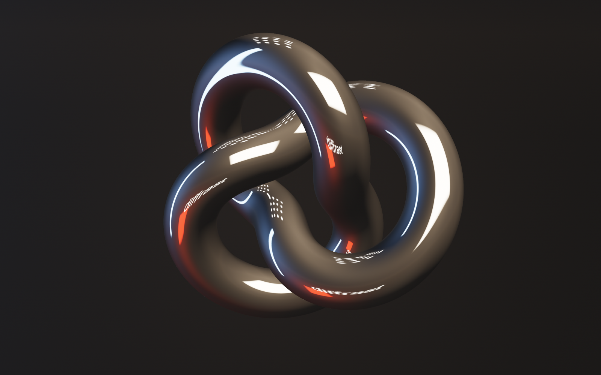
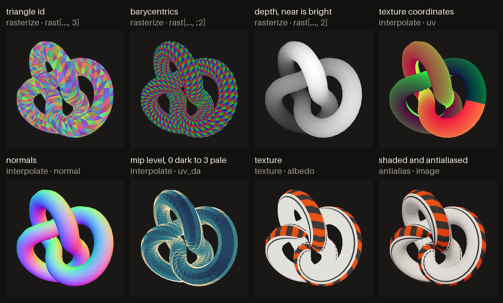
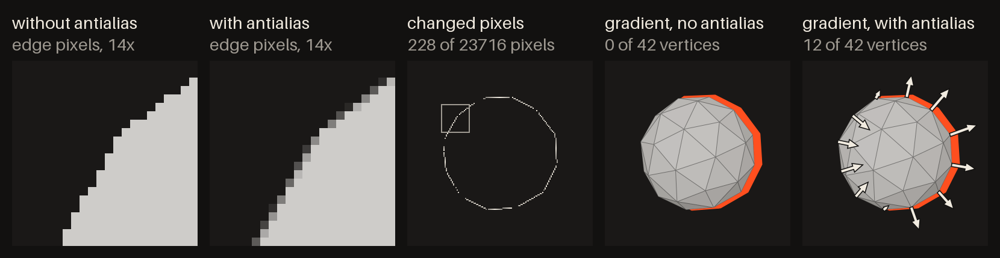
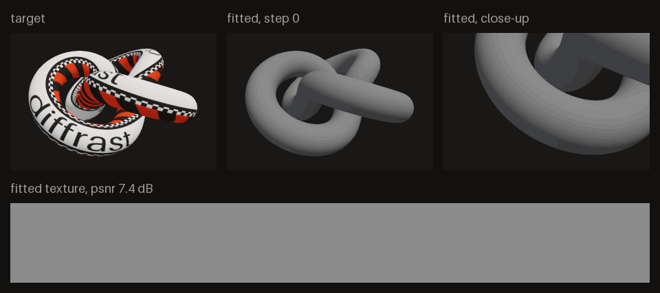
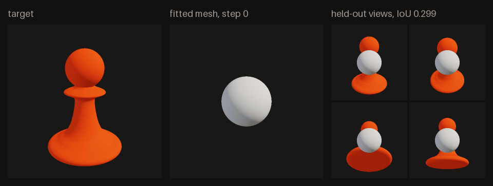
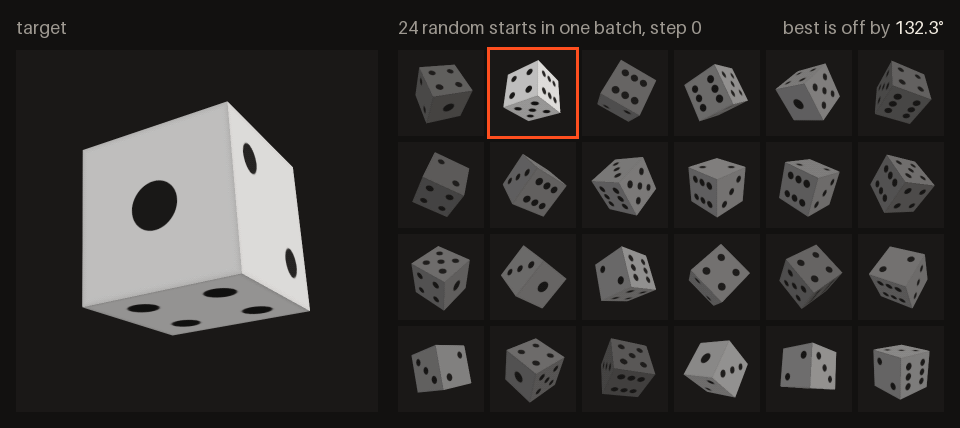
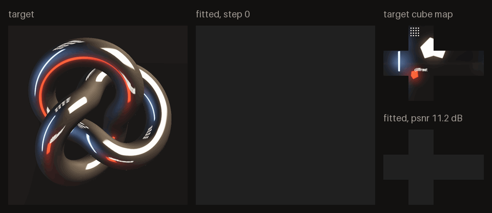
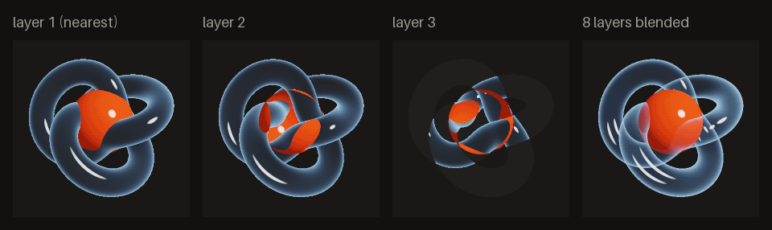
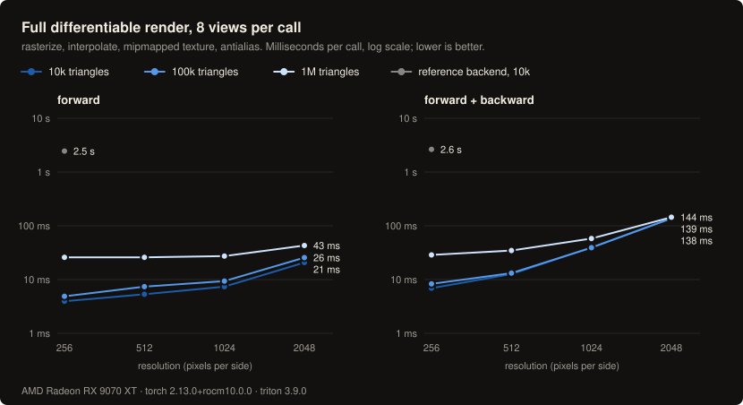

# diffrast

[](https://github.com/sennecools/diffrast/actions/workflows/ci.yml)
[](LICENSE)


A differentiable mesh rasterizer for PyTorch that runs on **AMD (ROCm) and NVIDIA (CUDA)** GPUs,
under the **MIT license**, with an API that mirrors [nvdiffrast](https://github.com/NVlabs/nvdiffrast).



*A torus knot reflecting a studio stored as a cube map, rendered by diffrast's four ops on an
AMD RX 9070 XT. The [environment-map example](#examples) recovers that cube map from renders of
the knot alone.*

> **Status: early development.** All ops work on Triton (AMD and NVIDIA) and on a pure-PyTorch
> reference backend. See the [roadmap](#roadmap).

## Why

Most image-to-3D, texturing and inverse-rendering pipelines render a mesh from several views and
backpropagate through the result. The standard tool for this, nvdiffrast, has two limitations:

- **It needs an NVIDIA GPU.** Pipelines built on it do not run on AMD hardware.
- **It is licensed for non-commercial use only** (NVIDIA Source Code License), and so is any
  derivative of its code.

diffrast is a clean-room implementation written in [Triton](https://github.com/triton-lang/triton),
so a single codebase targets both vendors, plus a pure-PyTorch reference backend that runs anywhere
and serves as ground truth for testing.

## Ops

| Op | Forward | Gradients to |
| --- | --- | --- |
| `rasterize(glctx, pos, tri, resolution)` | Per-pixel barycentrics, depth, triangle id; screen-space barycentric derivatives | `pos` |
| `interpolate(attr, rast, tri)` | Per-pixel vertex attributes (UVs, normals, colours) and their screen-space derivatives | `attr`, `rast` |
| `texture(tex, uv, uv_da=None)` | Nearest, bilinear and mipmapped lookups in 2D textures and cube maps | `tex`, `uv`, `uv_da`, mip levels |
| `antialias(color, rast, pos, tri)` | Analytic edge antialiasing, giving gradients at silhouettes | `color`, `pos` |
| `DepthPeeler(glctx, pos, tri, resolution)` | The surfaces behind the nearest one, one depth layer per call | `pos` |

All ops take a leading batch dimension, so several views render in one call.



*What each op produces, for a coarse torus knot: triangle ids, barycentrics and depth from
`rasterize`; texture coordinates, normals and the mip level their derivatives select from
`interpolate`; the texture lookup; and the shaded, antialiased image. See
[`examples/gbuffer.py`](examples/gbuffer.py).*

## Usage

```python
import torch
import diffrast as dr

glctx = dr.RasterizeContext()  # current GPU, or CPU if there is none

rast, rast_db = dr.rasterize(glctx, pos_clip, tri, resolution=(512, 512))
uv, uv_da = dr.interpolate(uv_attr, rast, tri, rast_db=rast_db, diff_attrs="all")
color = dr.texture(tex, uv, uv_da, filter_mode="linear-mipmap-linear")
color = dr.antialias(color, rast, pos_clip, tri)

loss = torch.nn.functional.mse_loss(color, target)
loss.backward()  # gradients reach tex and pos_clip
```

To render surfaces hidden behind the nearest one, `DepthPeeler` returns one depth layer per call,
each in the same format as `rasterize`:

```python
with dr.DepthPeeler(glctx, pos_clip, tri, resolution=(512, 512)) as peeler:
    layers = [peeler.rasterize_next_layer() for _ in range(4)]
```

Mip levels can be built once for a texture that does not change, given as a list of trainable
tensors, or used with cube maps:

```python
mip = dr.texture_construct_mip(tex)
color = dr.texture(tex, uv, uv_da, mip=mip)
color = dr.texture(levels[0], uv, uv_da, mip=levels[1:])  # custom, trainable levels
# cube: [batch, 6, size, size, channels]; dirs: direction vectors, dirs_da: their derivatives
env = dr.texture(cube, dirs, dirs_da, boundary_mode="cube")
```

### Why antialias matters

Which triangle a pixel shows is a step function of the vertex positions, so a plain render has no
gradient that moves an outline. `antialias` blends the pixels along silhouettes by how much of
each the edge covers, which makes the image, and so the loss, continuous in the vertices.



*A flat-shaded sphere compared with a shifted target (orange). Without antialias the gradient with
respect to the vertex positions is exactly zero; with it, the outline vertices get gradient
pointing towards the target, while only pixels on the outline change. The sphere is coarse on
purpose: on a finely tessellated mesh antialias finds a smaller share of the outline, as
[`docs/design.md`](docs/design.md#antialias) explains. See
[`examples/antialias_gradients.py`](examples/antialias_gradients.py).*

## Porting from nvdiffrast

Function names, argument names and argument order follow nvdiffrast's documented API, so code
ports by changing its import:

```python
import diffrast.torch as dr  # instead of: import nvdiffrast.torch as dr
```

`RasterizeCudaContext` and `RasterizeGLContext` are accepted and rasterize the same way, range mode
(a 2D `pos` with `ranges`) is supported, and `antialias_construct_topology_hash` and the log-level
functions exist. To run third-party code without editing it, call this once before importing it:

```python
import diffrast

diffrast.install_as_nvdiffrast()  # "import nvdiffrast.torch" now resolves to diffrast
```

It refuses to shadow an installed nvdiffrast unless `force=True`, and
`diffrast.uninstall_as_nvdiffrast()` undoes it. Differences worth knowing:

- A pixel centre exactly on an edge belongs to one of the triangles sharing it (a top-left rule),
  and zero-area triangles are not drawn, so a closed surface has exactly one layer per pixel.
- The edge adjacency `antialias` needs is cached per `tri` tensor, so a topology hash is optional.
  Pass the same `tri` tensor to every call rather than a fresh copy, or pass a topology hash.
- Indices in `tri` are validated.
- On the Triton backend, gradients are first order only; differentiating them again raises.
  Higher-order gradients need the reference backend.
- Mip chains are built for any texture size, averaging odd sizes by area.

### Backends

| Backend | Devices | Notes |
| --- | --- | --- |
| `triton` | CUDA and ROCm GPUs | Default on GPU when Triton is installed; cube-map lookups run in PyTorch |
| `reference` | Any PyTorch device | Pure PyTorch; slow, used for testing and as a fallback |

Select one with `dr.set_backend("reference")` or the `DIFFRAST_BACKEND` environment variable. On
the same device both backends choose the same triangle for every pixel.

## Examples

```bash
pip install -e . --group examples
python examples/texture_fitting.py --gif texture_fitting.gif
```

Every example runs on any supported GPU in about a minute or less, and on the CPU with
`--device cpu` and smaller sizes. They write nothing unless given an output path; the extension of
`--gif` picks GIF, WebP, or (with ffmpeg) MP4 and WebM. In all of them the targets are rendered by
diffrast itself and carry no noise, so the fits are close to exact; they show what gradients
through each op can do, not results on real photographs.

<table>
<tr><td width="50%">



**[Texture fitting](examples/texture_fitting.py).** A 2048 x 256 texture starts flat grey and is
optimised until its renders of a torus knot match the targets from random views.

</td><td width="50%">



**[Shape fitting](examples/shape_fitting.py).** A sphere with 10,242 vertices is deformed into a
chess pawn using only silhouettes and shading, through `antialias`.

</td></tr>
<tr><td>



**[Pose fitting](examples/pose_fitting.py).** The rotation of a die from one 64-pixel image: 24
random starts fitted in a single batched call, then the best one turned through the cube's
symmetries so the pips decide.

</td><td>



**[Environment map](examples/env_lighting.py).** A cube map that starts grey is recovered from
reflections on a mirror-like knot alone, with mipmapped cube lookups driven by `uv_da`.

</td></tr>
<tr><td colspan="2">



**[Depth peeling](examples/depth_peeling.py).** Order-independent transparency: `DepthPeeler`
returns the nearest surface in every pixel, then the one behind it, and so on; eight layers are
shaded, antialiased and blended front to back, and gradients pass through all of them.

</td></tr>
</table>

## Performance



One call renders 8 views of a displaced grid through `rasterize`, `interpolate` with derivatives,
a mipmapped lookup into a 1024 x 1024 texture and `antialias`; the backward pass carries gradients
to the vertex positions and the texture. Measured on an AMD RX 9070 XT with
[`benchmarks/bench_pipeline.py`](benchmarks/bench_pipeline.py):

| Triangles | 256² fwd / fwd+bwd | 512² | 1024² | 2048² |
| ---: | ---: | ---: | ---: | ---: |
| 10k | 4.0 / 6.9 ms | 5.3 / 12.7 ms | 7.4 / 39.6 ms | 20.8 / 139 ms |
| 100k | 4.9 / 8.3 ms | 7.4 / 13.2 ms | 9.4 / 39.2 ms | 25.6 / 138 ms |
| 1M | 25.9 / 28.8 ms | 25.9 / 34.7 ms | 27.3 / 57.9 ms | 43.1 / 144 ms |

The reference backend takes about 2.5 s for the smallest case. At high resolutions the backward
pass dominates: at 10k triangles and 2048², half of it is scattering gradients into the texture,
where many pixels share a texel, and a quarter is gathering position gradients for vertices that
thousands of pixels share. No NVIDIA numbers yet.

## Installation

diffrast is not on PyPI yet. Install PyTorch for your platform first
([CUDA or ROCm build](https://pytorch.org/get-started/locally/)), then:

```bash
pip install git+https://github.com/sennecools/diffrast
```

Linux builds of PyTorch ship with Triton. On Windows, install
[`triton-windows`](https://github.com/triton-lang/triton-windows), which supports both NVIDIA
and AMD GPUs.

### AMD GPUs on Windows

AMD publishes ROCm builds of PyTorch for Windows on its own package index. The GPU kernels come
in a separate package per architecture, selected with an extra (`device-gfx1201` for the
RX 9070 series; see `torch.cuda.get_arch_list()` for the names):

```bash
pip install --index-url https://stable.repo.amd.com/rocm/whl-next/ --extra-index-url https://pypi.org/simple "torch[device-gfx1201]==2.13.0+rocm10.0.0"
pip install triton-windows
```

Pin the `+rocm` version: without the pin, a newer CPU-only `torch` from PyPI can win the
resolution. Tested with `torch 2.13.0+rocm10.0.0` and `triton-windows 3.9.0.post30` on an
RX 9070 XT.

## Roadmap

- [x] Public API and input validation
- [x] Reference and Triton backends for `rasterize`, `interpolate`, `texture` and `antialias`
- [x] Depth peeling, range mode, cube maps and custom mip levels
- [x] nvdiffrast compatibility: `diffrast.torch`, `RasterizeGLContext`, `install_as_nvdiffrast`
- [x] Examples: texture, shape, pose and environment-map fitting; depth peeling; G-buffer
- [x] Benchmarks on AMD
- [ ] Benchmarks on NVIDIA
- [ ] Cube-map lookups in Triton kernels
- [ ] PyPI release

## Development

```bash
git clone https://github.com/sennecools/diffrast
cd diffrast
python -m pip install --upgrade pip  # --group needs pip 25.1+
pip install -e . --group dev --group examples
pytest
```

CI runs the reference backend, the public API and the examples on Linux and Windows with CPU
PyTorch. The Triton backend tests (`tests/test_triton.py` and the tests marked `gpu`) need a CUDA
or ROCm device and are skipped in CI, so the CI badge does not cover the Triton kernels. Run them
locally with `pytest -m gpu`; the setup they have been run on is the one listed under
[AMD GPUs on Windows](#amd-gpus-on-windows).

See [CONTRIBUTING.md](CONTRIBUTING.md) for guidelines and [docs/design.md](docs/design.md) for how
the rasterizer works.

## License

MIT. See [LICENSE](LICENSE).

diffrast is an independent project and is not affiliated with or endorsed by NVIDIA.
